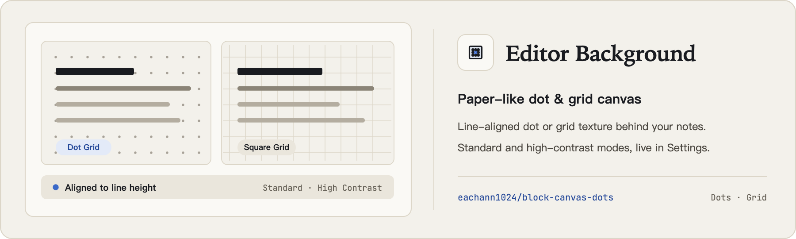

<picture>
  <source media="(prefers-color-scheme: dark)" srcset="assets/card-en-dark.png">
  <source media="(prefers-color-scheme: light)" srcset="assets/card-en-light.png">
  
</picture>

Like writing in a dotted notebook or on grid paper in GoodNotes, this plugin adds a subtle dot or grid pattern to your writing area. Every dot and line aligns cleanly with each line of text, making long notes easier to scan without losing your place.

- **Three paper styles**: Switch anytime between None, Dots, and Grid to match how you like to write.
- **Two contrast levels**: Choose between Standard and High contrast so the pattern stays clear without distracting from your words.
- **Editor or Fullscreen scope**: Keep the paper pattern inside the editor column or extend it across the main workspace window chrome (automatically clearing the top brand artwork band and outline rail while keeping floating panels, menus, and dialogs isolated; excludes dedicated full-window modes and standalone Quick Note windows).
- **Instant preview and reset**: Changes take effect as soon as you pick them in plugin settings, with one-click Reset Default.

**Install**: Open Block Settings -> App Store and search **Editor Background**, or enter `blockmd-plugins/block-canvas-dots`.
