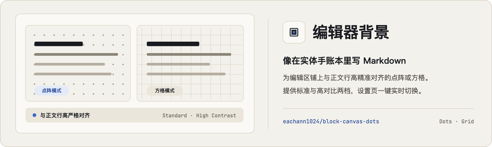

<picture>
  <source media="(prefers-color-scheme: dark)" srcset="assets/card-zh-dark.png">
  <source media="(prefers-color-scheme: light)" srcset="assets/card-zh-light.png">
  
</picture>

像使用纸质点阵手账本或方格纸一样，给写作区铺上一层点阵或方格底纹。每个点、每条线都精准对齐每一行文字，写长文或整理笔记时视线更稳，不容易看串行。

- **三种底纹样式**：可在无底纹、点阵、方格之间随时切换，写草稿或长文都能找到顺眼的纸感。
- **两档深浅调节**：提供标准与高对比两种深浅度，浅色或深色主题下都清晰但不抢文字的风头。
- **正文区域与铺满编辑区**：支持仅在居中正文列展示，或铺满整块编辑区画布（不含侧边栏与顶栏，从画布边框自然起格不压边，自动避开大纲刻度与各类悬浮层）。
- **实时生效与还原**：在插件设置页点选即刻看到效果，自动保存，随时支持一键恢复默认。

**安装**：打开 Block「设置 → 应用商店」搜索 **编辑器背景**，或手动填入 `blockmd-plugins/block-canvas-dots`。
